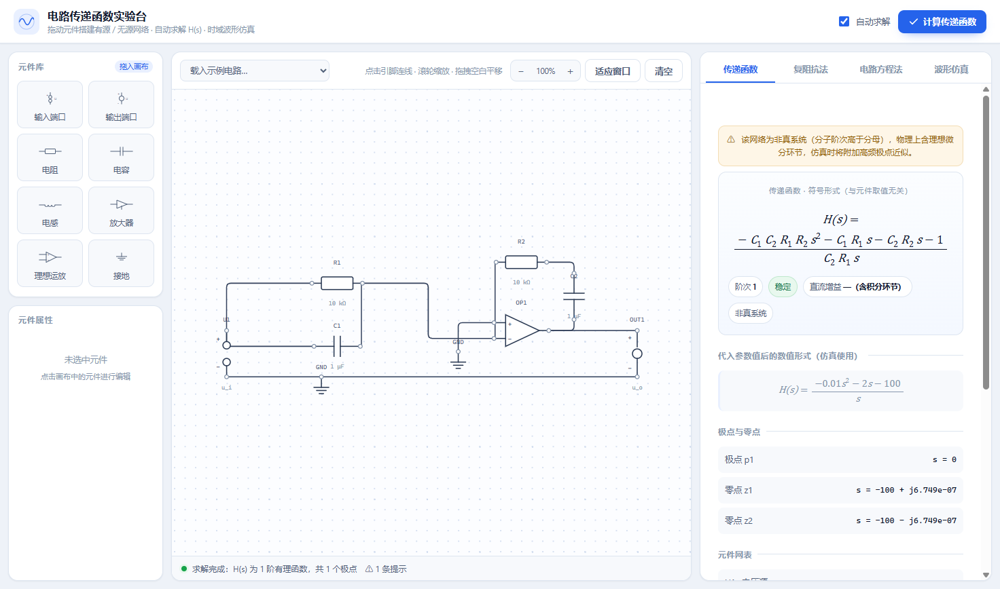

# 自动控制原理 · 电路求传递函数实验台

> 拖拽搭电路，一键得到传递函数。面向《自动控制原理》课程的电路建模与频域/时域演示工具。

在画布上摆电阻、电容、电感、受控源和理想运放，用导线连起来，右侧会立刻给出该电路的
**传递函数**（符号式 + 数值式）、**阶次与极点零点**、**稳定性判断**，以及
「复阻抗法」和「电路方程法」两套可直接抄进作业的推导过程；下方还能叠加阶跃、方波、
斜坡、加速度、正弦激励，看输入输出波形和超调量、上升时间、调节时间等指标。

整个系统是本地运行的：后端 FastAPI + NumPy/SciPy/SymPy，前端是零依赖的原生 JS + SVG
自绘电路编辑器。除了源码运行，也提供打包好的 Windows 可执行文件，**对方不需要安装
Python 或任何环境**，双击即用。

---

## 目录

- [界面预览](#界面预览)
- [功能特性](#功能特性)
- [内置示例](#内置示例)
- [快速开始](#快速开始)
- [求解原理](#求解原理)
- [接口说明](#接口说明)
- [项目结构](#项目结构)
- [常见问题](#常见问题)

---

## 界面预览



左栏是元件库，中间是画布，右侧是求解结果与推导步骤。画布支持滚轮缩放、空白处拖动平移、
「适应窗口」一键复位；导线自动按横平竖直布线并做圆角过渡，交叉处不画接点、真正相连处才
出现接点圆点。

---

## 功能特性

### 电路编辑

- **8 类元件**：电阻 R、电容 C、电感 L、输入电压源 U1、输出端 OUT、放大器 AMP、
  理想运放 OPAMP、接地 GND。
- **横平竖直布线**：导线只有水平和垂直线段，拐角带 8 px 圆角，交叉与连接在视觉上区分
  （只有真正连通的引脚才出现接点圆点）。
- **缩放与平移**：滚轮以光标为中心缩放，空白处拖动平移，工具栏显示当前缩放比例，
  一键适应窗口。
- **双击旋转**：电阻、电容、电感和运放支持 90° 旋转，方便画垂直支路。
- **参数面板**：选中元件后可改参数，电阻/电容/电感使用工程单位（kΩ、μF、mH……）。

### 求解结果

- **双形式传递函数**：先给只含符号（`R₁`、`C₁`、`K₁`）的解析式，再给代入真实参数后的
  数值有理分式，两边对照，便于理解「公式」与「具体电路」的关系。
- **极点零点与稳定性**：给出极点、零点、阶次、直流增益，并判断稳定 / 临界 / 不稳定。
- **两套推导步骤**：
  - *复阻抗法*：先把每个元件写成 `Z(s)`，再用串并联与分压得到 `H(s)`；
  - *电路方程法*：列出节点方程 / 回路方程，消元后得到同一个结果。
- **非真系统提示**：含理想微分（如 PID、PD）的电路分子阶次不低于分母，会明确提示并
  在仿真时自动附加高频极点近似。

### 时域仿真

- 5 种激励：阶跃、方波、斜坡、加速度、正弦，可调幅值、频率、占空比、初相。
- 自动选择仿真时长（按最慢极点的时间常数与信号周期估计），也可手动指定。
- 阶跃响应给出**超调量、峰值时间、上升时间、调节时间、稳态值**。

---

## 内置示例

顶部「示例」下拉框内置 9 个可直接载入并求解的电路：

| 示例 | 说明 | 传递函数 |
| --- | --- | --- |
| RC 一阶低通 | 二端口画法，不画接地符号 | `1 / (R₁C₁s + 1)` |
| RC 一阶高通 | 带接地符号 | `R₁C₁s / (R₁C₁s + 1)` |
| RLC 串联谐振 | R、L、C 串联取电容电压 | `1 / (LCs² + RCs + 1)` |
| 有源一阶低通 | RC 网络 + 放大器 | `K / (R₁C₁s + 1)` |
| 双 RC 两级网络 | 两级 RC 直接串联（有负载效应） | `1 / (R₁C₁R₂C₂s² + (R₁C₁+R₂C₂+R₁C₂)s + 1)` |
| **PID 调节器** | 理想运放，`Z_in = R₁‖C₁`，`Z_f = R₂ + 1/(sC₂)` | `−K_p(1 + 1/(T_i s) + T_d s)` |
| **PD 比例微分** | 理想运放，`Z_in = R₁‖C₁`，`Z_f = R₂` | `−(R₂/R₁)(1 + R₁C₁s)` |
| **串级双 RC** | 两级 RC，各经增益 1 的缓冲隔离 | `(1/(R₁C₁s+1)) · (1/(R₂C₂s+1))` |
| **前馈电容补偿** | 与 R₁ 并联的前馈电容引入零点 | `(C_fR₁s + 1) / ((C₁+C_f)R₁s + 1)` |

以 PID 示例（`R₁=R₂=10 kΩ`，`C₁=C₂=1 μF`）为例，解得的符号式为

```
        −(C₁C₂R₁R₂s² + (C₁R₁ + C₂R₂)s + 1)
H(s) = ─────────────────────────────────────
                   C₂R₁s
```

代入数值即 `H(s) = −(0.01s² + 2s + 100)/s`，也就是 `K_p = 2`、`K_d = 0.01`、`K_i = 100`
的反相型理想 PID。

串级与前馈两个示例放在一起对照，可以直观看到：**串级**靠缓冲隔离把两级传函直接相乘，
而**前馈**是在分母不变的前提下引入一个零点，让相位提前。

---

## 快速开始

### 方式一：直接运行（推荐给没有 Python 环境的同学）

1. 打开 [Releases](../../releases) 页面，下载 `电路传递函数实验台-Windows-x64.zip`；
2. 解压到任意目录，双击 `CircuitTFLab.exe`；
3. 程序会在本机启动服务并自动打开浏览器（默认 <http://127.0.0.1:8848>，
   端口被占用时自动顺延）；
4. 关闭黑色命令行窗口即退出。

> 服务只监听 `127.0.0.1`，不联网、不上传任何数据。

### 方式二：源码运行

```bash
git clone https://github.com/dingjq1216/circuit-tf-lab.git
cd circuit-tf-lab
pip install fastapi uvicorn numpy scipy sympy

# 启动（会自动打开浏览器）
python launcher.py

# 或者用 uvicorn 直接起服务，再手动访问
python -m uvicorn backend.main:app --host 127.0.0.1 --port 8848
```

依赖：Python ≥ 3.10，`fastapi`、`uvicorn`、`numpy`、`scipy`、`sympy`。

### 方式三：自己打包 exe

```bash
pip install pyinstaller
pyinstaller --noconfirm --clean --name CircuitTFLab --console ^
            --add-data "frontend;frontend" launcher.py
```

打包产物在 `dist/CircuitTFLab/`。`backend/main.py` 已处理冻结后的静态资源路径
（`sys._MEIPASS`），无需额外改动。

---

## 求解原理

后端的求解流程（`backend/circuit_solver.py`）分四步：

1. **拓扑解析**：用并查集把导线连起来的引脚合并成电气节点；悬空的源负端、输出负端、
   放大器接地脚按规则归到参考节点。教材图常常不画接地符号，此时以电压源负端为 0 V。
2. **列写方程**：用改进节点法（MNA）在 s 域建方程 `M x = b`。
   - 电阻、电容、电感以其导纳 `1/R`、`sC`、`1/(sL)` 冲入节点；
   - 电压源、放大器、理想运放作为额外支路扩充矩阵；
   - 理想运放采用**虚短**模型 `V₊ = V₋`，输入端不取电流，输出电流由外电路决定，
     因此可以搭反相比例、积分、微分、PID 等反馈电路。
3. **求解输出**：解出输出端电压 `V_out(s)`，除以输入 `V_in(s)` 得 `H(s)`。
4. **化简与格式化**：符号模式全程用 SymPy 精确计算，数值模式先用有理数避免浮点误差，
   再 `cancel` 成最简有理分式，最后生成 LaTeX、极点零点、稳定性与两套推导步骤。

放大器（AMP）与理想运放（OPAMP）的区别值得说明：AMP 是三端受控源
`V_out = K·V_in`，输出电流经它的接地脚返回，适合画「理想放大器」；OPAMP 才是真正的
运算放大器，虚短约束让它能构成各种负反馈网络——最初的 PID 示例用 AMP 搭出来的结果
退化成了 `H(s)=1`，正是因为输出电流在接地点被吸收、反馈回路没有真正闭合。

---

## 接口说明

| 方法 | 路径 | 说明 |
| --- | --- | --- |
| `GET` | `/api/health` | 健康检查 |
| `POST` | `/api/analyze` | 输入元件表与导线表，返回传递函数、极点零点、稳定性、推导步骤 |
| `POST` | `/api/simulate` | 输入 `{tf, signal}`，返回采样点、性能指标与提示 |

`/api/analyze` 的请求体：

```json
{
  "components": [
    {"id": "src", "type": "SRC", "name": "U1", "x": 120, "y": 424},
    {"id": "r1",  "type": "R",   "name": "R1", "value": 10000},
    {"id": "c1",  "type": "C",   "name": "C1", "value": 1e-6, "rot": 90}
  ],
  "wires": [
    {"a": ["src", "a"], "b": ["r1", "a"]},
    {"a": ["r1", "b"],  "b": ["c1", "a"]}
  ]
}
```

`x`、`y`、`rot` 只影响画面，求解只看 `components` 的 `type`/`value` 与 `wires` 的连接关系。

---

## 项目结构

```
├── backend/
│   ├── main.py             # FastAPI 入口：API 与前端静态资源托管
│   ├── circuit_solver.py   # 并查集 + MNA 求解传递函数，生成推导步骤
│   └── simulator.py        # 信号发生与时域响应、性能指标
├── frontend/
│   ├── index.html
│   ├── css/app.css
│   └── js/
│       ├── editor.js       # SVG 电路编辑器：拖拽、旋转、正交布线、缩放平移
│       ├── app.js          # 界面装配、调用后端、结果渲染
│       ├── examples.js     # 内置示例电路
│       ├── plot.js         # 波形绘制
│       └── latex.js        # 轻量公式渲染
├── launcher.py             # 桌面启动入口：找空闲端口 + 自动开浏览器
├── 使用说明.txt             # 打包分发包里的用户手册
└── docs/images/            # README 图片
```

---

## 常见问题

**Q：为什么 PID/PD 的传递函数会提示「非真系统」？**
理想微分环节 `s` 让分子阶次不低于分母，物理上不可实现，但对求传递函数没有影响。
做时域仿真时程序会自动附加一个高频极点做近似，并在结果中给出提示。

**Q：为什么有的示例没有接地符号？**
教材里的二端口网络常只标 `u_i`、`u_o`，不画地。程序会自动以电压源负端作为 0 V 参考点，
两种画法都能求解。

**Q：画了两个接地符号会不会冲突？**
不会。所有 GND 元件在求解时被视为同一个参考节点，适用于运放电路里「输入地」和
「电源地」分开画的情况。

**Q：可以求电流传输函数或者二端口 Z/Y 参数吗？**
目前只输出电压比 `V_o(s)/V_i(s)`，但二端口画法已经支持，后续可以扩展。

---

## License

[MIT](LICENSE) © 2026 dingjq1216
